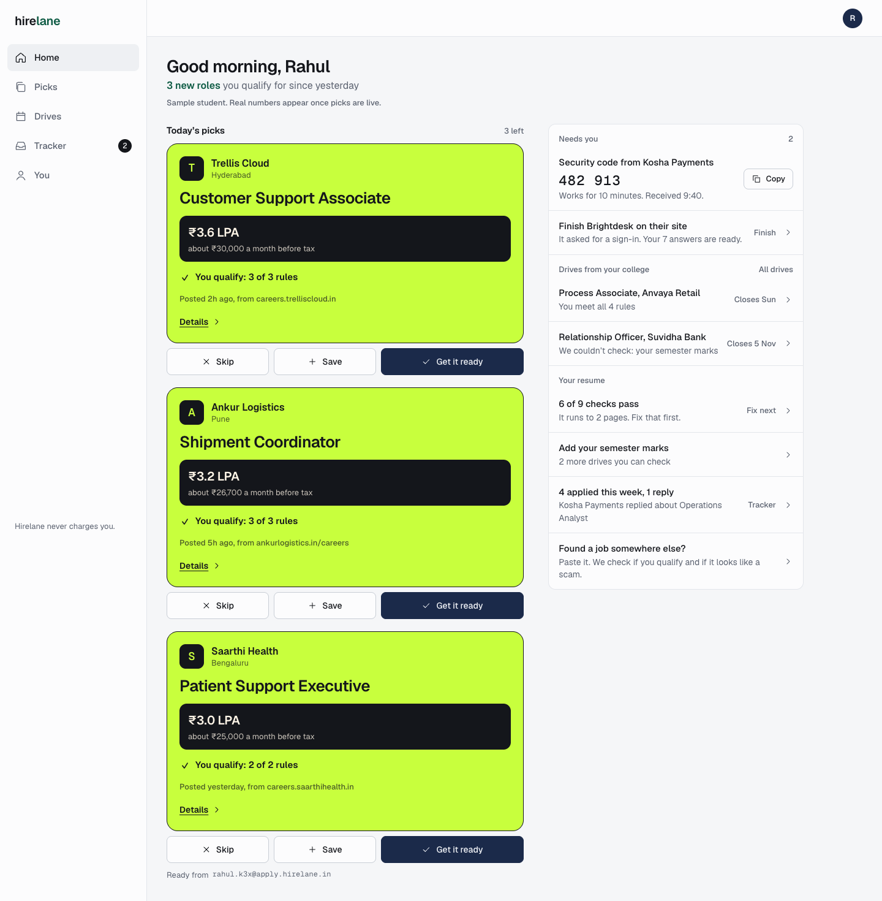

# HireLane

A job platform for students that on-campus drives didn't place. It has two parts that share one Postgres database:

1. **A public job board** built only from public ATS APIs (Greenhouse, Lever, Ashby). Every posting is enriched with a normalised salary that shows its derivation, structured must-have and nice-to-have requirements, skills, level, workplace and visa, and a canonical company entity. People, search crawlers (sitemaps, SEO list pages) and AI agents (`llms.txt`, a public JSON API, `Accept: text/markdown`) can all read it.
2. **An application agent.** A student uploads a resume once and gets ranked matches, each with a match score that shows its maths. They triage one card at a time. The agent drafts every answer, but anything it must not guess (visa, start date, salary, EEO) is flagged **Needs you**. The finished application goes to the employer's own form. It is never submitted without the student's explicit consent, and HireLane never gets past a CAPTCHA, bot check or login on their behalf.

Placement cells pay; students use it free when their college does. The screens are designed for phone-only students on low-end Android and metered data.



## Architecture

```
 Greenhouse · Lever · Ashby  (fixtures in tests, live APIs in prod)
              │
 workers/runner   graphile-worker on Postgres
   ingest every 6h → enrich → embed → match → draft → digest
              │   withAdmin (ingest, ops) · withUser (per-user, RLS enforced)
              ▼
 packages/db      Postgres 16 + pgvector · numbered SQL migrations, checksum-verified
              ▲
 apps/web         Next.js 15 App Router, React 19
   public board · /api/public · /api/v1 · student app · campus console
```

| Package | Owns |
|---|---|
| `packages/engine` | Pure, test-first logic: salary parsing and normalisation, skills taxonomy, requirement extraction, classifiers, dedup keys, match scoring |
| `packages/ingest` | ATS connectors, fixture recorder, posting persistence and diffing |
| `packages/agent` | LLM providers (Anthropic, fixture, null), embeddings, resume parsing, answer drafting, handoff |
| `packages/db` | Drizzle schema, `withAdmin`/`withUser` clients, migration runner, RLS/schema/auth verifiers |
| `packages/vault`, `packages/services` | Sensitive-field storage and shared service errors |
| `workers/runner` | Queue tasks and crontab |
| `apps/web` | Pages, server actions, route handlers |

`pnpm lint:deps` (dependency-cruiser) enforces these package boundaries.

## Engineering choices

- **Tenant isolation in the database.** Per-user work runs as a restricted role with `SET LOCAL hirelane.user_id`, so Postgres row-level security enforces isolation even if application code has a bug. `pnpm db:verify-rls` checks the policies.
- **Migrations you can't quietly rewrite.** Migrations are hand-numbered SQL files. The runner records a checksum for each one and refuses to apply a migration that was edited after it ran.
- **No fabrication.** With the LLM off, extraction uses deterministic engine rules, and drafting fills only from the student's structured profile. Any free-text field it can't fill becomes Needs you.
- **LLM spend guardrails.** Real model calls need an explicit flag plus a key. Models are checked against an allowlist at startup, and there is a monthly USD cap and a per-student daily call limit. Every call's token usage is recorded; prompt content never is.
- **Hostile-input resume parsing.** PDF and DOCX uploads go through magic-byte checks, a zip-bomb guard with streamed byte caps, and no XML entity expansion. PDFs are parsed with JavaScript execution disabled.

## Run it

Requires Node 22.18 or newer (see `.nvmrc`), pnpm 9 and Docker. No API keys are needed: ingest, the LLM and embeddings all run from local fixtures by default.

```bash
pnpm install
pnpm db:up && pnpm db:migrate && pnpm db:seed
pnpm dev                       # http://localhost:3001
```

`pnpm verify` runs everything CI does: tests, typecheck, dependency boundaries, product guards, engine evaluation, and schema, RLS and auth verification.

## Docs

Architecture: [`docs/architecture.md`](docs/architecture.md). Ingest: [`docs/ingest.md`](docs/ingest.md). Enrichment: [`docs/enrichment.md`](docs/enrichment.md). Public API: [`docs/public-api.md`](docs/public-api.md). Campus: [`docs/campus.md`](docs/campus.md). Deploying the demo: [`docs/DEPLOY-DEMO.md`](docs/DEPLOY-DEMO.md). The full plan and its amendments are in [`PLAN.md`](PLAN.md).

## Contributing

Contributions are welcome. Pick an issue labelled [enhancement](https://github.com/adhikbuilds/hirelane/labels/enhancement) and read [CONTRIBUTING.md](CONTRIBUTING.md) for setup and the project rules.
